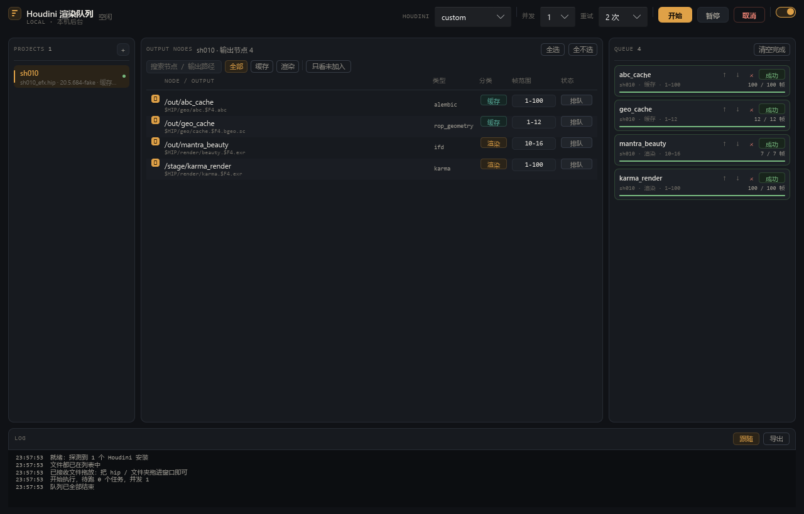
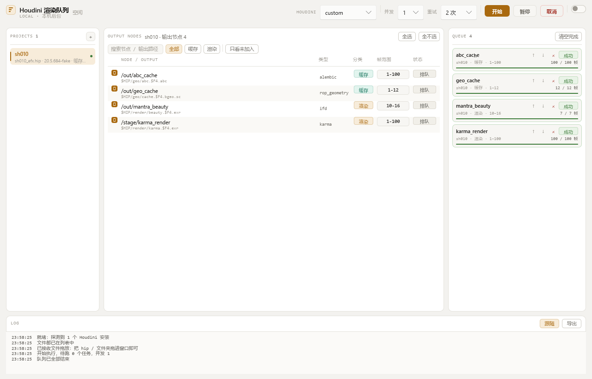

# Houdini Render Queue

本机桌面工具，用来管理 Houdini 的后台缓存与渲染队列。把 `.hip` 拖进窗口，自动分析可输出节点，勾选入队后按顺序后台执行。

## 功能

- **拖入 hip**：支持从资源管理器拖入文件或文件夹，也可点 `+` 添加
- **自动分析**：识别 `/out` 的 ROP、`/stage` 的 LOP 渲染节点，以及 `/obj` 下的 File Cache SOP（`filecache::2.0`）
- **逐节点设置**：每个节点独立修改帧范围，勾选即入队；缓存排在渲染之前
- **Houdini 版本**：探测本机所有安装；每个 hip 默认按文件里记录的制作版本匹配，也可手动锁定
- **执行控制**：默认串行，并发数可调；失败重试；按帧断点续渲；预检输出目录与磁盘空间
- **界面**：三栏布局 + 最右侧独立日志列；暗/亮主题；统一字体设置；跟随与导出日志

## 结构

```
src/          Rust/Slint 主程序（队列调度、Windows 原生拖放、SQLite 状态库）
ui/app.slint  Slint 界面定义
python/
  analyze.py  在 hython 中加载 hip，枚举输出节点，输出 JSON
  render.py   在 hython 中按帧执行，逐帧回报进度，支持取消与断点续渲
devtest/      不启动 Houdini 也能跑回归的假 hou 模块
```

## 构建

需要 Rust 工具链（edition 2024）：

```bash
cargo build --release
```

产物在 `target/release/houdini-render-queue.exe`。运行时把 `python/` 目录放在 exe 同级，程序会按 `exe/python/` 定位脚本。

## 运行

直接双击 exe，拖入 `.hip` 即可。命令行调试开关：

```
--add <hip>              启动时添加工程
--run                    启动后立即开始队列
--drop-test <path>       自检原生拖放通道
--snapshot <file.bmp>    生成界面快照（可配 --snapshot-delay <毫秒>）
--light                  强制亮色主题
--probe-version <hip>    探测 hip 的制作版本
--set-font <字体> <字号> 调试：切换字体并落库
--set-version <下标>     调试：切换当前工程的 Houdini 版本
--font-panel             调试：直接打开字体面板
```

## 环境

- Windows 10/11
- Houdini 安装目录默认在 `C:\Program Files\Side Effects Software\Houdini *`，也可用环境变量 `HRQ_HYTHON` 指定（分号分隔多个 hython.exe 路径）
- 状态库存放在 `%APPDATA%\HoudiniRenderQueue\state.db`

## 界面预览





