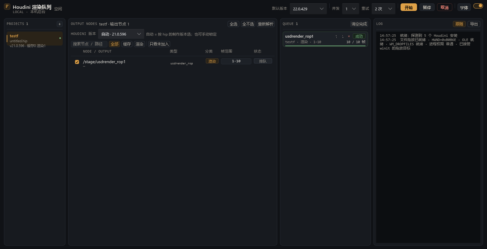

# Houdini Render Queue

本机桌面工具，用来管理 Houdini 的后台缓存与渲染队列。把 `.hip` 拖进窗口，自动分析可输出节点，勾选入队后按顺序后台执行。

## 功能

- **拖入 hip**：支持从资源管理器拖入文件或文件夹，也可点 `+` 添加
- **自动分析**：识别 `/out` 的 ROP、`/stage` 的 LOP 渲染节点，以及 `/obj` 下的 File Cache SOP（`filecache::2.0`）
- **逐节点设置**：每个节点独立修改帧范围（单击定位光标、双击整段选中），勾选即入队；缓存排在渲染之前
- **不连续帧**：帧范围可以写 `1001-1060`，也可以写 `1052,1055,1056,1065-1070`（逗号/分号/顿号分隔，区间分隔符认 `-` `–` `~` `至`；相邻帧提交后自动并成区间）
- **Houdini 版本**：探测本机所有安装；每个 hip 默认按文件里记录的制作版本匹配，也可手动锁定
- **执行控制**：默认串行，并发数可调；失败重试；按帧断点续渲；预检输出目录与磁盘空间
- **队列整理**：执行区卡片可上下调序、单条取消；「清空完成」摘掉已结束的任务；「重新开始」清零全部帧进度并重跑整批（两步确认，防误触）
- **界面**：三栏布局 + 最右侧独立日志列；底部状态栏显示当前 hip 完整路径与版本/节点统计；暗/亮主题；统一字体设置（本机全部系统字体，可搜索）；跟随与导出日志

## 结构

```
src/          Rust/Slint 主程序（队列调度、Windows 原生拖放、SQLite 状态库）
ui/app.slint  Slint 界面定义
python/
  analyze.py  在 hython 中加载 hip，枚举输出节点，输出 JSON
  render.py   在 hython 中按帧执行，逐帧回报进度，支持取消与断点续渲
assets/       app.ico（exe 图标）+ app.png（窗口图标）+ app.rc（资源脚本）
tools/        make_icon.py 生成图标；peek_icon.py / peek_window_icon.py 校验图标是否生效
devtest/      不启动 Houdini 也能跑回归的假 hou 模块
```

## 构建

需要 Rust 工具链（edition 2024）：

```bash
cargo build --release
```

产物在 `target/release/houdini-render-queue.exe`。运行时把 `python/` 目录放在 exe 同级，程序会按 `exe/python/` 定位脚本。

release 构建使用 Windows 图形子系统，双击不弹控制台窗口；`cargo build`（debug）仍保留控制台，便于看 `eprintln!` 日志。hython 子进程统一走 `pyproc::hidden()`，带 `CREATE_NO_WINDOW`，不会闪黑框。

### 图标

`build.rs` 会调用 Windows SDK 的 `rc.exe` 把 `assets/app.rc`（内含 `app.ico`）编进 exe；rc.exe 不在 PATH 时按 `RC` 环境变量 → PATH → `Windows Kits\10\bin\*` 顺序自动找，找不到只警告、不影响构建。窗口图标走 `ui/app.slint` 的 `icon:`（`assets/app.png`），任务栏大图标由 `windrop::set_big_icon()` 从 exe 资源补上（winit 只设小图标）。

改图标：编辑 `tools/make_icon.py` 的配色/形状后

```bash
python tools/make_icon.py --variant b --preview out.png   # 先看效果
python tools/make_icon.py --variant b                     # 生成 assets/app.ico + app.png
python tools/peek_icon.py dist/houdini-render-queue.exe check.png   # 校验 exe 图标
```

## 运行

直接双击 exe，拖入 `.hip` 即可。命令行调试开关：

```
--add <hip>              启动时添加工程
--run                    启动后立即开始队列
--drop-test <path>       自检原生拖放通道
--snapshot <file.bmp>    生成界面快照（可配 --snapshot-delay <毫秒>）
--light                  强制亮色主题
--probe-version <hip>    探测 hip 的制作版本
--set-font <字体> <字号> 调试：切换字体并落库
--set-version <下标>     调试：切换当前工程的 Houdini 版本
--font-panel             调试：直接打开字体面板
--font-filter <词>       调试：预置字体搜索词
--list-fonts             调试：打印枚举到的系统字体（含序号）后退出
--debug-invoke <回调名>  调试：直接触发一次按钮回调（clear-finished / restart-all），配合 --snapshot 做回归
```

## 分发到其他电脑

`cargo build --release` 的产物已经自包含，拷过去就能跑，目标机不用装任何运行库：

- **CRT 静态链接**（`.cargo/config.toml` 里的 `+crt-static`）：不依赖 `VCRUNTIME140.dll` 和 VC++ 2015-2022 运行库；
- **`python/` 目录要跟 exe 一起拷**（`analyze.py`、`render.py`），放在 exe 同级；
- 目标机要求：Windows 10/11 x64 + 装了 Houdini（或用 `HRQ_HYTHON` 指定 hython）。没有 Houdini 能开界面，但解析会失败。

打不开时按顺序排查：

| 现象 | 原因 | 处理 |
| --- | --- | --- |
| 「此应用无法在你的电脑上运行 / 请联系应用发行者」 | Win11 **智能应用控制**（Smart App Control）拦了未签名程序 | 设置 → 隐私和安全性 → Windows 安全中心 → 应用和浏览器控制 → 智能应用控制 → 关闭（关掉后要重装系统才能再开）；或给 exe 做代码签名 |
| 「找不到 VCRUNTIME140.dll」 | 拿到的是静态链接之前的旧包 | 换 `dist/houdini-render-queue.exe` 新版 |
| 双击后什么都没发生 | 系统低于 Win10，或 32 位系统 | 不支持；需 Win10/11 x64 |
| 「Windows 已保护你的电脑」 | SmartScreen 对无签名新程序的首启提示 | 点「更多信息」→「仍要运行」 |

## 环境

- Windows 10/11
- Houdini 安装目录默认在 `C:\Program Files\Side Effects Software\Houdini *`，也可用环境变量 `HRQ_HYTHON` 指定（分号分隔多个 hython.exe 路径）
- 状态库存放在 `%APPDATA%\HoudiniRenderQueue\state.db`

## 界面预览




